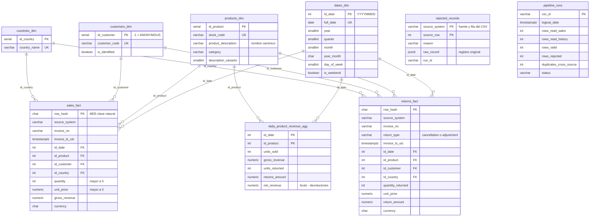

# Modelo de datos del repositorio analítico

[English](data_model.md) | **Español**

Modelo dimensional del esquema `dwh` del PostgreSQL analítico. Tiene **dos tablas de hechos** (`sales_fact` y `returns_fact`) que comparten cuatro **dimensiones conformadas** (`dates_dim`, `products_dim`, `customers_dim` y `countries_dim`), más un agregado producto-día. Por eso el modelo completo es una **constelación de hechos** (*fact constellation* o *galaxy schema*): cada proceso de negocio, visto por separado, es una estrella. Por qué se diseñó así: [decisiones técnicas, sección 2](technical_decisions.es.md#2-modelo-del-repositorio-analítico).

Para la versión interactiva, importa [`data_model.dbml`](data_model.dbml) en [dbdiagram.io](https://dbdiagram.io/d). El DDL completo está en [`sql/ddl/`](../sql/ddl).

## Diagrama entidad-relación

Cada línea es una relación de uno a muchos: una fila de dimensión se relaciona con muchas filas de hechos. Las tablas `rejected_records` y `pipeline_runs` (esquema `audit`) aparecen sin relaciones porque son de trazabilidad, no de análisis.

El mismo diagrama en Mermaid (GitHub lo dibuja; `data_model.png` se generó a partir de él):

## Diccionario de tablas

| Tabla | Grano (una fila por...) | Uso analítico |
|---|---|---|
| `dwh.dates_dim` | Día calendario | Filtrar y agrupar por año, trimestre, mes o día de la semana. |
| `dwh.products_dim` | Código de producto (`stock_code`) | Analizar ventas y devoluciones por producto y categoría; `description_variants` responde la pregunta 6. |
| `dwh.customers_dim` | Cliente, más el miembro anónimo | Comparar clientes identificados contra operaciones sin `CustomerID` (pregunta 5). |
| `dwh.countries_dim` | País normalizado | Distribución geográfica y ticket por país (pregunta 4). |
| `dwh.sales_fact` | Línea de factura válida con cantidad > 0 | Unidades vendidas y revenue bruto. |
| `dwh.returns_fact` | Línea de devolución o ajuste (cantidad ≤ 0, guardada en positivo) | Unidades e importes devueltos, por tipo. |
| `dwh.daily_product_revenue_agg` | Combinación producto + día | Bruto, devoluciones y neto (preguntas 1, 2, 3 y 7). |

> **Convenciones:** `id_date` es un entero `YYYYMMDD` calculado sobre la fecha UTC; `customers_dim.id_customer = -1` es `ANONYMOUS`; los importes están en GBP (columna `currency`); `row_hash` es el MD5 de la clave natural de la línea y es la llave primaria de los hechos, así que identifica cada fila de forma determinista entre ejecuciones.

## Restricciones que garantizan el modelo

Cada línea del diagrama es una `FOREIGN KEY` física en [`sql/ddl/03_facts.sql`](../sql/ddl/03_facts.sql):

| Tabla | Llave primaria | Llaves foráneas |
|---|---|---|
| `sales_fact` | `row_hash` | `fk_fact_sales_date`, `fk_fact_sales_product`, `fk_fact_sales_customer`, `fk_fact_sales_country` |
| `returns_fact` | `row_hash` | `fk_fact_returns_date`, `fk_fact_returns_product`, `fk_fact_returns_customer`, `fk_fact_returns_country` |
| `daily_product_revenue_agg` | `pk_daily_product_revenue` (`id_date`, `id_product`) | `fk_fact_agg_date`, `fk_fact_agg_product` |

Además, `CHECK` refuerzan las reglas de negocio: `ck_sales_quantity_positive` y `ck_sales_price_positive` en ventas, `ck_returns_type_valid` en devoluciones y `ck_agg_net_matches` (`net_revenue = gross_revenue - returns_amount`) en el agregado. Las dimensiones tienen llaves naturales únicas (`uq_products_stock_code`, `uq_customers_code`, `uq_countries_name`, `uq_dates_full_date`).

## Tablas de soporte (fuera del modelo dimensional)

| Esquema | Tabla | Contenido |
|---|---|---|
| `staging` | `products_stg`, `sales_stg`, `returns_stg` | Tablas `UNLOGGED` de paso para el `COPY` masivo; se vacían en cada ejecución. No son dimensiones ni hechos. |
| `audit` | `rejected_records` | Fila rechazada: fuente, número de fila en el CSV, motivo y registro original en `JSONB`. |
| `audit` | `pipeline_runs` | Bitácora por ejecución: filas leídas, válidas, rechazadas, duplicadas entre fuentes y estado. |
