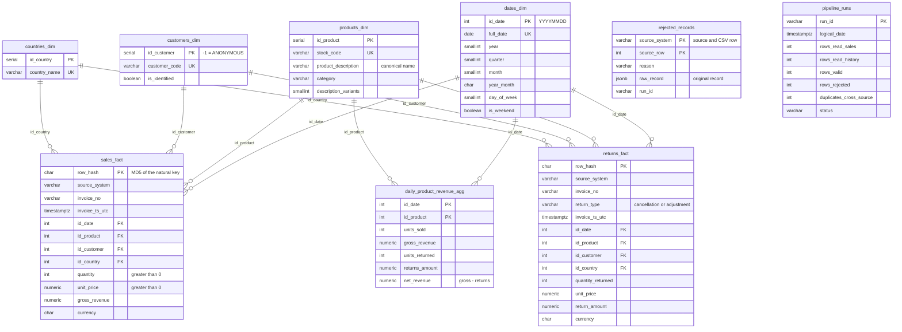

# Analytical warehouse data model

**English** | [Español](data_model.es.md)

Dimensional model of the `dwh` schema in the analytical PostgreSQL. It has **two fact tables** (`sales_fact` and `returns_fact`) that share four **conformed dimensions** (`dates_dim`, `products_dim`, `customers_dim` and `countries_dim`), plus a product-day aggregate. That makes the full model a **fact constellation** (*galaxy schema*): each business process, seen on its own, is a star. Why it is designed this way: [technical decisions, section 2](technical_decisions.md#2-analytical-warehouse-model).

For the interactive version, import [`data_model.dbml`](data_model.dbml) at [dbdiagram.io](https://dbdiagram.io/d). The full DDL is in [`sql/ddl/`](../sql/ddl).

## Entity-relationship diagram

Each line is a one-to-many relationship: one dimension row relates to many fact rows. `rejected_records` and `pipeline_runs` (`audit` schema) have no relationships because they are for traceability, not analysis.

The same diagram in Mermaid (GitHub renders it; `data_model.png` was generated from it):

## Table dictionary

| Table | Grain (one row per...) | Analytical use |
|---|---|---|
| `dwh.dates_dim` | Calendar day | Filter and group by year, quarter, month or weekday. |
| `dwh.products_dim` | Product code (`stock_code`) | Analyze sales and returns by product and category; `description_variants` answers question 6. |
| `dwh.customers_dim` | Customer, plus the anonymous member | Compare identified customers with transactions without `CustomerID` (question 5). |
| `dwh.countries_dim` | Normalized country | Geographic distribution and ticket per country (question 4). |
| `dwh.sales_fact` | Valid invoice line with quantity > 0 | Units sold and gross revenue. |
| `dwh.returns_fact` | Return or adjustment line (quantity ≤ 0, stored as positive) | Units and amounts returned, by type. |
| `dwh.daily_product_revenue_agg` | Product + day combination | Gross, returns and net (questions 1, 2, 3 and 7). |

> **Conventions:** `id_date` is a `YYYYMMDD` integer computed on the UTC date; `customers_dim.id_customer = -1` is `ANONYMOUS`; amounts are in GBP (`currency` column); `row_hash` is the MD5 of the line's natural key and the primary key of the facts, so it identifies each row deterministically across runs.

## Constraints that enforce the model

Every line in the diagram is a physical `FOREIGN KEY` in [`sql/ddl/03_facts.sql`](../sql/ddl/03_facts.sql):

| Table | Primary key | Foreign keys |
|---|---|---|
| `sales_fact` | `row_hash` | `fk_fact_sales_date`, `fk_fact_sales_product`, `fk_fact_sales_customer`, `fk_fact_sales_country` |
| `returns_fact` | `row_hash` | `fk_fact_returns_date`, `fk_fact_returns_product`, `fk_fact_returns_customer`, `fk_fact_returns_country` |
| `daily_product_revenue_agg` | `pk_daily_product_revenue` (`id_date`, `id_product`) | `fk_fact_agg_date`, `fk_fact_agg_product` |

`CHECK` constraints also enforce the business rules: `ck_sales_quantity_positive` and `ck_sales_price_positive` on sales, `ck_returns_type_valid` on returns and `ck_agg_net_matches` (`net_revenue = gross_revenue - returns_amount`) on the aggregate. Dimensions have unique natural keys (`uq_products_stock_code`, `uq_customers_code`, `uq_countries_name`, `uq_dates_full_date`).

## Support tables (outside the dimensional model)

| Schema | Table | Content |
|---|---|---|
| `staging` | `products_stg`, `sales_stg`, `returns_stg` | `UNLOGGED` landing tables for the bulk `COPY`; emptied on every run. Not dimensions or facts. |
| `audit` | `rejected_records` | Rejected row: source, row number in the CSV, reason and original record as `JSONB`. |
| `audit` | `pipeline_runs` | Run log: rows read, valid, rejected, duplicated across sources and status. |
