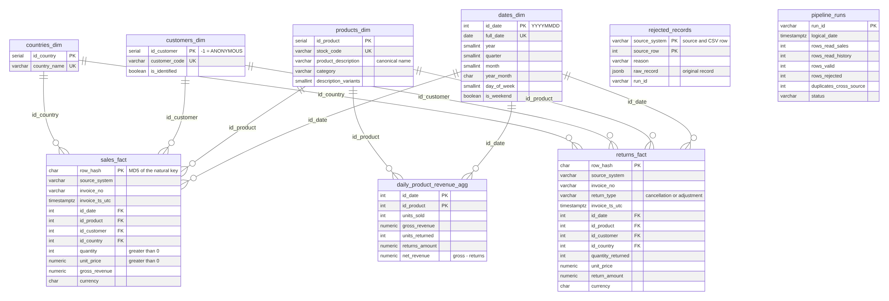
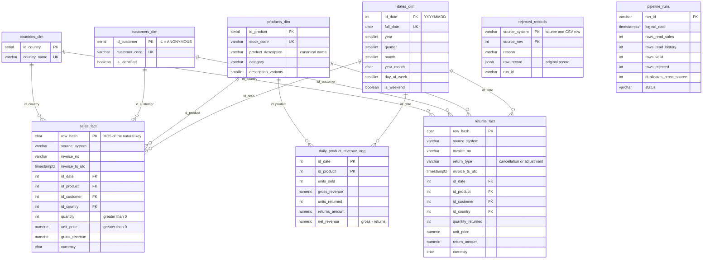

# Data model diagram

**English** | [Español](data_model.es.md)

Star schema in the `dwh` schema of the analytical PostgreSQL. GitHub draws the diagram below automatically. For the dbdiagram.io version, import [`data_model.dbml`](data_model.dbml). The full DDL is in [`sql/ddl/`](../sql/ddl). Why it is designed this way: [technical decisions, section 2](technical_decisions.md#2-analytical-warehouse-model).

The same diagram in Mermaid (GitHub renders it; `data_model.png` was generated from it):

## Support tables (not related to the star schema)

| Schema | Table | Content |
|---|---|---|
| `staging` | `products_stg`, `sales_stg`, `returns_stg` | `UNLOGGED` landing tables for the bulk `COPY`; emptied on every run. |
| `audit` | `rejected_records` | Rejected row: source, row number in the CSV, reason and original record as `JSONB`. |
| `audit` | `pipeline_runs` | Run log: rows read, valid, rejected, duplicated across sources and status. |
